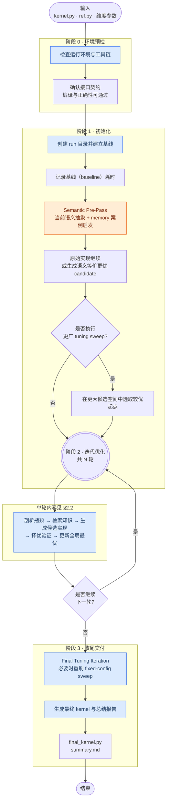
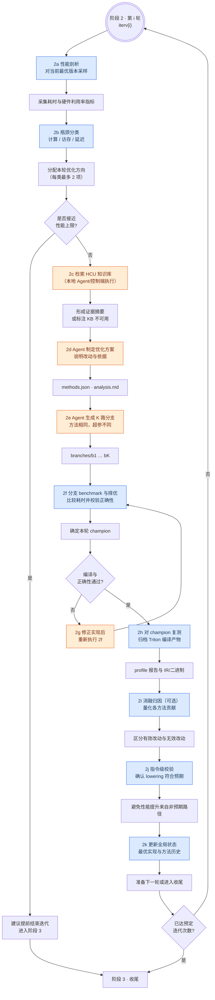
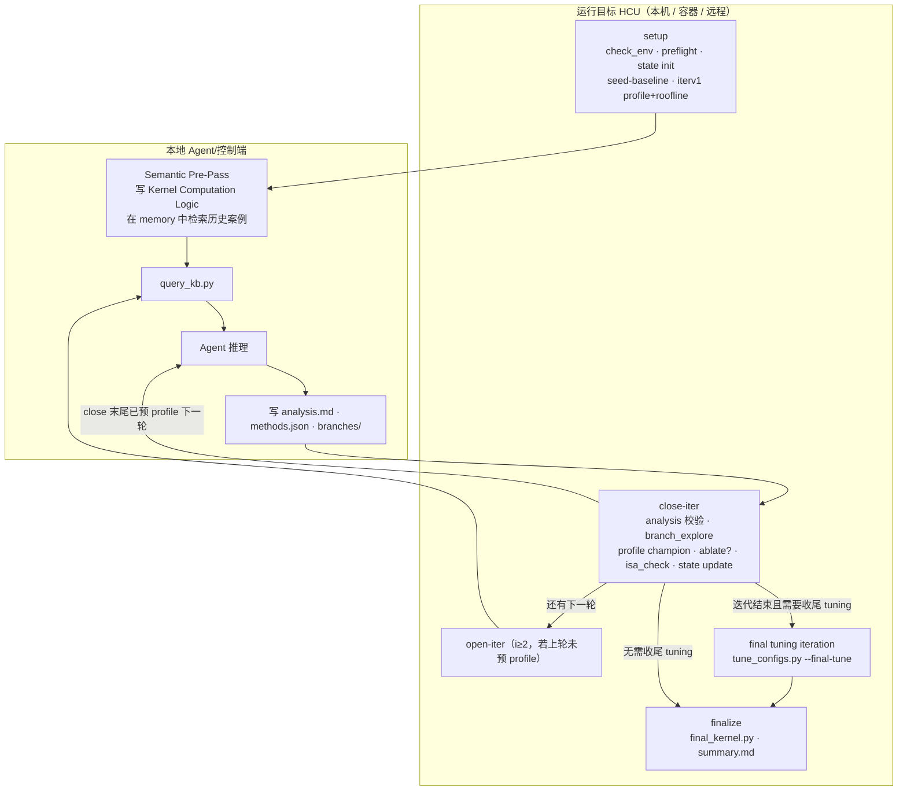

# Hygon Triton Kernel Optimizer — 技能介绍

> 路径：`skills/operator-tuning/kernel-triton-optimize/`
> 适用场景：在 **海光 HCU / HCU** 上，对 **Python + Triton** 算子做**可复现、有证据链**的迭代性能优化。

---

## 1. 这个 Skill 解决什么问题？

在 Hygon HCU 上优化 Triton kernel，难点通常不在「改几行 Python」，而在：

- Triton 会经历 **TTIR → TTGIR → AMDGCN → hsaco** 多阶段 lowering，表面上的 `tl.load` / `tl.dot` 与最终 HCU ISA 可能不一致；
- gfx936 / gfx938 等架构在 **MMAC layout（legacy vs interleave）**、FP8/MLS、buffer op 等行为上不同；
- 若允许 `@triton.autotune` 自由搜索，很难区分「算法优化」与「碰巧搜到更快 config」；
- 性能结论需要 **xcu/XCompute 指标（优先）或 hipprof 降级证据 + roofline 分类 + TTGIR/ISA 校验 + 消融归因** 才能站得住脚。

本 Skill 提供一套 **语义预分析、Roofline 驱动、分支择优、固定 config、证据分层** 的闭环工作流：Agent 负责推理与改码，脚本负责在**运行目标 HCU**（本机/容器/远程）上产生可审计的 benchmark / profile / IR / ISA 产物。`orchestrate.py setup` 建立 baseline 与第 1 轮画像后，先执行 `Semantic Pre-Pass`：`triton_semantic_prepass.md` 负责当前 kernel 的公式抽象、loop/candidate 盘点和证据门槛；`triton_optimization_memory.md` 负责历史案例检索，包括直接 pattern 匹配、类比启发、负例和复用 guard。若能证明等价，先形成更好的 Triton candidate，再进入 `tune_configs.py` 和 compute / memory / latency 轴优化。

**与 HIP 优化 skill 的关系**：Triton skill 使用 `triton.*` 方法命名与 `isa_check.py`，区别于 HIP skill 的 `compute.*` 方法体系。正常迭代不做逐条 HIP 方法映射；如需移植 HIP 思路，应以 Triton source、TTGIR、AMDGCN/hsaco ISA 与 correctness/timing 证据重新归因。

**若无初始 kernel**：先用兄弟 skill `kernel-triton-baseline` 从 `ref.py` + shape JSON 生成 `kernel.py` / `ref.py` 基线，再进入本优化器。

---

## 2. 完整优化流程图（简明版）

建议先阅读 **阶段总览（§2.1）**，再阅读 **单轮迭代步骤（§2.2）**。图中图例：

- **蓝色**：运行目标 HCU 上由脚本自动执行（测量、验证、状态更新；本机/容器/远程均可）
- **橙色**：由 Agent 完成（知识检索、方案制定、代码修改）
- **灰色菱形**：条件分支

> 产物文件名及与 `SKILL.md` 字母步骤的对应关系见 **§2.5**。

### 2.1 阶段总览



### 2.2 单轮迭代步骤（2a–2k，与 SKILL.md 一致）

每轮在 **当前全局最优实现** 基础上推进；目标为在保持正确性的前提下降低耗时。步骤编号与 `SKILL.md` 第 2 轮字母子步骤相同（**2a … 2k**）。

> **读图说明**
> - **步骤编号**（与 `SKILL.md` 一致）：看方括号里的 **`2a` … `2k`**（对应 SKILL 正文 `a.` … `k.`）。
> - **`S1`、`S8` 等**：只是本图 Mermaid 的**内部节点名**（连线、上色用），**不是** SKILL 步骤号；`S1` 对应内容 **2a**，`S8` 对应 **2h**，以此类推见下表。
> - **`O1`、`O8` 等**：表示该步产出，同样只是绘图 ID。

| 图节点 | 步骤 | 图节点 | 步骤 |
|--------|------|--------|------|
| S1 | 2a | S7 | 2g |
| S2 | 2b | S8 | 2h |
| S3 | 2c | S9 | 2i |
| S4 | 2d | S10 | 2j |
| S5 | 2e | S11 | 2k |
| S6 | 2f | | |



### 2.3 执行位置分工

```text
  运行目标 HCU                本地 Agent/控制端             运行目标 HCU
  ─────────                   ──────────                   ─────────
  2a 剖析  2b 分类    ──►   2c 知识库检索
  (i=1 在 setup 已完成)              │
                               2d 方案  2e 分支实现
                                    │
                               ─────┴──────►  2f 择优  ──►  (失败 → 2g 重跑 close-iter)
                                                    │
                                               2h  2i?  2j  2k 验证与状态更新
                                                    │
                               下一轮 2a+2b：open-iter 或 close 末尾已预 profile
```

### 2.4 主要分支条件

| 分支 | 判定条件 | 建议处理 |
|------|----------|----------|
| **提前结束** | Roofline 显示 compute / memory / latency 三轴均已接近上限 | 进入阶段 3，撰写总结报告 |
| **本轮失败** | 分支编译失败，或与 `ref.py` 结果不一致 | Agent 修正代码或配置后，重新执行 **2f**（`close-iter`） |
| **继续迭代** | 本轮产生有效 champion，且 `i < N` | 以更新后的全局最优为输入，开始第 `i+1` 轮 **2a** |

### 2.5 与 SKILL.md 步骤对照

| SKILL 步骤 | 流程简述 | 主要产物 / 脚本 |
|------------|----------|-----------------|
| **0** | 环境预检 | `env.json`（`check_env.py`）；`preflight.py` 通过（无单独产物文件） |
| **1** `setup` | 初始化与基线 | `run_*/`、`state.json`、`baseline/bench.json`；**第 1 轮已含 2a+2b**：`iterv1/hcu_top.json`、`iterv1/roofline.json` |
| **1** pre-pass | 语义预分析与更优 candidate | 用 `triton_semantic_prepass.md` 做当前公式/loop/candidate 分析；用 `triton_optimization_memory.md` 做历史案例检索、类比启发和复用 guard 判断；必要时生成语义等价的更优 candidate；可写 `tuning_space.json` |
| **1** optional | 更广固定 config tuning（可选） | `iterv{i}/tune_results.json`、`accepted_configs.json`、`config_acceptance.md`（`tune_configs.py --search-level broad`） |
| **2a** | 性能剖析 | `iterv{i}/hcu_top.json`（`profile_hcu.py` → xcu 优先 / hipprof 降级） |
| **2b** | 瓶颈分类 | `iterv{i}/roofline.json` |
| **2c** | 知识库检索（本地） | `kb_evidence.md` 或 `kb_unavailable.json`（`query_kb.py`） |
| **2d** | 制定方案 | `methods.json`、`analysis.md` |
| **2e** | 生成分支 | `iterv{i}/branches/b1..bK/`（可选各分支 `config.json`） |
| **2f** | 分支择优 | `kernel.py`、`bench.json`、`branch_results.json`、`attempt_timeline.json`（`branch_explore.py`） |
| **2g** | 修正重试 | 修码后重跑 **`orchestrate.py close-iter`**（非单独跑 branch_explore） |
| **2h** | champion 复测 | 更新 `hcu_top.json`；`kernel.xcu` / `kernel.hipprof`（或 xcu 输出目录）；`irs/`（`extract_triton_irs.py`） |
| **2i** | 消融归因（可选） | `attribution.json`（**仅当 Agent 已写 `ablations/{method_id}/`** 时 `ablate.py` 才执行） |
| **2j** | 指令级校验 | `isa_check.json` |
| **2k** | 状态更新 | `state.json`（`state.py update`；**此处完整校验 `methods.json`**） |
| **3-pre** final tuning | 收尾 tuning 迭代 | 若前面 promoted 了算法/source rewrite/config/branch/shape bucket，则先开 `iterv{last+1}` 跑 `tune_configs.py --final-tune --promote-if-better`；产出 `tune_results.json`、`accepted_configs.json`、`config_acceptance.md`，必要时更新 `state.best_config` |
| **3** `finalize` | 收尾交付 | `summary.md`、`final_kernel.py`、`final_config.json`、`final_kernel_manifest.json`；Agent 判断本轮是否有可沉淀到 `triton_optimization_memory.md` 的类似 pattern / 语义优化 |

**与 `orchestrate.py` 的额外对应关系（SKILL 正文未逐条写出）：**

- **第 1 轮**：**2a+2b** 在 `setup` 中完成，无需再跑 `open-iter --iter 1`。
- **第 2 轮起**：**2a+2b** 来自 `open-iter`，或上一轮 `close-iter` **末尾已预跑**下一轮的 profile + roofline（可跳过 `open-iter`）。
- **`validate_methods.py`**：`close-iter` 开头默认只校验 `analysis.md`（`--analysis`）；`methods.json` 的 registry / `axis_budget` 合规性在 **`state.py update`** 时校验。Agent 可在写分支前手动执行 `validate_methods.py --methods … --state …`。
- SKILL 中 “cache archive”：指 profile 阶段 Triton cache/IR 收集（`irs/`），不是 `finalize` 的独立子命令。

---

## 3. 整体架构：本地推理 + 运行目标取证

运行目标可以是 **本机 HCU、本机容器或 SSH 远程**（见 `SKILL.md` Runtime Target），下图不强制「必须远程」。



| 角色 | 做什么 | 不做什么 |
|------|--------|----------|
| **本地 Agent/控制端** | Semantic Pre-Pass、历史类似 pattern 参考、KB 检索、方法选择、写 kernel / config / `analysis.md`；可读 JSON 决策 | 不在运行目标安装 KB |
| **运行目标 HCU** | `orchestrate` 编排下的 benchmark、`profile_hcu`、Triton cache/IR、`isa_check`（dccobjdump）、`state` 更新 | 不做无证据的架构/ codegen 结论 |

SSH、容器进入、产物拷回等执行细节由当前上下文中可用的 shell、SSH、容器或编排机制处理；本 skill 不依赖额外的执行类 skill。它只要求 `scripts/` 在用户选定的运行目标 shell 中调用，并保留 benchmark/profile/IR/ISA 等证据（与 Agent 是否在同一台机器无关）。

---

## 4. 输入契约（开始前必须满足）

### 4.1 文件

| 文件 | 要求 |
|------|------|
| `kernel.py` | 暴露 `setup(**kwargs)` 与 `run_kernel(**kwargs)` |
| `ref.py` | 暴露 `reference(**kwargs)`；**Python 可调用的正确性对照**，可为纯 Python / PyTorch / Triton / HIPC，或通过 Python 接口封装其他 backend；**不要求 PyTorch**。裸 `.hip/.cpp` ref 需先包成 `ref.py` 才能进入 benchmark。 |
| shape JSON | 如 `{"M":4096,"N":4096,"K":4096}` 或 `{"N":16777216}` |

### 4.2 `setup()` 返回值（固定 config 纪律的核心）

```python
{
  "inputs": {...},
  "outputs": ["out"],
  "kernel_kwargs": {...},       # 传给 @triton.jit 的 constexpr / config
  "reference_inputs": {...},    # 可选
  "active_config": {...},       # 本次 benchmark 实际使用的 config
  "config_source": "fixed|registry|fallback|baseline|none",
  "config_key": "...",
  "config_hit": True,
}
```

**固定 config 要求**：

- 所有 benchmark / profile 必须带 `--disable-autotune`；
- `bench.json` 必须记录 `active_config`；
- 若无法证明 config 固定，应标记 **profiling degraded**，不能把 timing 归因于某个「算法方法」。
- **默认** `orchestrate` / `run_iteration` / `tune_configs` / `branch_explore` / `ablate` / `profile_*` 使用 `scripts/benchmark.py` 的默认模式：仍跑一次 Python 可调用的 `reference()` 做正确性，**不计时 ref**；优化目标始终是 `kernel.py`。复杂算子优先用**原始 Triton/HIP 语义 ref 的 Python wrapper**，避免 PyTorch ref 又慢又在边界/索引上与 Triton 不一致。需要 `speedup_vs_reference` 时显式传 `--bench-reference`。

### 4.3 推荐 kernel 骨架

```python
DEFAULT_CONFIG = {"BLOCK_M": 128, "BLOCK_N": 128, "BLOCK_K": 32, "num_warps": 4, "num_stages": 2}

def setup(**kwargs):
    cfg = dict(DEFAULT_CONFIG)
    cfg.update(kwargs.get("config") or {})
    return {
        "inputs": {...},
        "outputs": ["out"],
        "kernel_kwargs": cfg,
        "active_config": cfg,
        "config_source": "fixed" if kwargs.get("config") else "baseline",
        ...
    }
```

---

## 5. 一次完整 Run 的目录结构

运行 `orchestrate.py setup` 后，在 case 目录旁生成：

```text
run_YYYYMMDD_HHMMSS/
├── env.json                 # Python/Triton/xcu/hipprof/dccobjdump/架构
├── state.json               # 全局状态机（best、方法历史、roofline 历史）
├── baseline/
│   ├── kernel.py            # 原始 baseline 副本（永久对照）
│   └── bench.json           # baseline 计时（永不覆盖）
├── iterv1/
│   ├── best_input.xcu       # 对「当前 best」的 xcu profile（输入侧，若可用）
│   ├── best_input.hipprof   # xcu 不可用或失败时的降级 profile
│   ├── hcu_top.json         # 结构化 top 指标（含 xcu_kernel_filter、selected_kernel）
│   ├── roofline.json        # Δ_c/Δ_m/Δ_l + axis_budget + near_peak
│   ├── kb_evidence.json/md  # 或 kb_unavailable.json
│   ├── methods.json         # 本轮选定方法
│   ├── analysis.md          # CoT 诊断 + 方法理由
│   ├── branches/b1..bK/     # 分支 kernel + config.json
│   ├── kernel.py            # 本轮 champion（close-iter 后）
│   ├── bench.json           # champion 计时 + correctness
│   ├── kernel.xcu           # champion xcu profile（若可用）
│   ├── kernel.hipprof       # xcu 不可用或失败时的降级 profile
│   ├── triton_cache/        # profile 时固定的 TRITON_CACHE_DIR（原始 Triton cache）
│   │   ├── best_input/<profiler>_<timestamp>_<pid>/ ...
│   │   └── kernel/<profiler>_<timestamp>_<pid>/ ...
│   ├── best_input.artifact_manifest.json # best_input IR 抽取 manifest
│   ├── kernel.artifact_manifest.json     # champion IR 抽取 manifest
│   ├── artifact_manifest.json # 最近一次抽取结果的快捷 manifest（供 ISA/summary 使用）
│   ├── irs/                 # 从 triton_cache 抽取/归档的 Triton IR 与 code object
│   │   ├── best_input/<cache-key>/
│   │   │   ├── *.ttir       # 若 Triton 生成
│   │   │   ├── *.ttgir
│   │   │   ├── *.amdgcn
│   │   │   └── *.hsaco
│   │   └── kernel/<cache-key>/
│   │       ├── *.ttir
│   │       ├── *.ttgir
│   │       ├── *.amdgcn
│   │       └── *.hsaco
│   ├── attribution.json     # 消融（若有 ablations/）
│   ├── isa_check.json       # TTGIR + dccobjdump 校验
│   └── attempt_timeline.json # 分支/config 尝试的时间线事件
├── iterv2/ ...
├── iterv{final_tune}/       # 若需要收尾 tuning iteration
│   ├── tune_results.json
│   ├── accepted_configs.json
│   ├── config_acceptance.md
│   ├── attempt_timeline.json
│   └── config.json          # 仅当 --promote-if-better 接受了更快 final config
├── final_kernel.py          # finalize：烘焙 DEFAULT_CONFIG 的交付物
├── final_config.json
├── final_kernel_manifest.json
├── irs/
│   └── final_cache/<cache-key>/ # final gate 固定 config 后再次捕获的 Triton IR/cache 归档
│       ├── *.ttir
│       ├── *.ttgir
│       ├── *.amdgcn
│       └── *.hsaco
├── attempt_timeline.svg     # summary.md 引用的尝试时间线图
└── summary.md               # 总结报告（脚本生成证据章节，Agent 补充 Retrospective）
```

---

## 6. 迭代流程（逐步说明）

### 阶段 0：环境与预检

```bash
python scripts/check_env.py --out ./env.json
python scripts/preflight.py --baseline ./kernel.py --ref ./ref.py --dims '{"N":16777216}'
```

在任何 benchmark / profiler（优先 `xcu`，降级 `hipprof`）前，先用 `rocm-smi`、`hy-smi` 或等价工具检查可见 HCU 的 compute / memory 使用率。优先选择空闲或使用率最低的卡，并通过 `HIP_VISIBLE_DEVICES` / `CUDA_VISIBLE_DEVICES` 固定到该卡。若无法独占或所有卡都繁忙，后续 timing / profiler 证据需要标记为可能受污染；小幅收益不应作为最终结论，必要时在空闲卡上重跑。

确认 Triton active target（例如运行环境检测到的 `gfx...`）、`xcu` / `hipprof` / `dccobjdump` 是否可用。`xcu` 缺失时 workflow 会降级到 `hipprof`，但 `summary.md` 必须提示安装 `xcu`；profiler 工具缺失时 workflow 仍可跑 benchmark，但 **roofline / ISA 会降级**。

### 阶段 1：Setup（初始化 + 第 1 轮 open-iter）

```bash
python scripts/orchestrate.py setup \
  --baseline ./kernel.py \
  --ref ./ref.py \
  --dims '{"N":16777216}' \
  --iterations 3 \
  --branches 4 \
  --disable-autotune
```

内部顺序：

1. `state.py init` → 创建 `run_*`、`baseline/` 副本、`iterv1..N/`；
2. `seed-baseline` → 记录 **baseline 时间**（`baseline/bench.json`）；
3. `profile_hcu --which best_input` → 对当前 best（初始即 baseline）采样，优先 `xcu`、失败再用 `hipprof`；
4. `roofline.py` → 计算三轴 gap 与 **axis_budget**。

Setup  stdout 会给出 `early_stop` 与 `next_step` 指引。

#### 1.B 本地 Agent：Semantic Pre-Pass（`setup` 后、`tune_configs.py` 前）

首次优化必须在 `orchestrate.py setup` 之后、初始 `tune_configs.py` 之前完成这一段：

1. 按 `references/triton_semantic_prepass.md` 的分析输出要求填写 `iterv1/analysis.md`：`## Kernel Computation Logic`、`## Formula-First Analysis`、`## Loop / Candidate Inventory`、`## Semantic Pre-Pass Result`；不要机械填表，优先写清算法级候选和 try/reject/defer 证据；
2. 用 `references/triton_semantic_prepass.md` 做当前 kernel 的语义抽象与候选启发：公式、loop/index/mask、try/reject/defer 证据；
3. 用 `references/triton_optimization_memory.md` 做历史案例检索：直接匹配、类比启发、负例/拒绝的 entry、复用 guard 和原因都要写入 `analysis.md`；不要求同名 kernel，也不要求完全同 op；
4. 若候选 rewrite 可由 `ref.py`（Python 可调用，内部可封装任意 backend）正确性、shape/stride/aliasing contract 证明等价，则先生成或推广更好的 Triton candidate；
5. 若能从 `setup()` / `_config()` / `DEFAULT_CONFIG` 看出可调 key，则由 Agent 粗定 tuning 空间，写 `iterv1/tuning_space.json`；
6. 将 promoted / rejected 语义 candidate 写入 `analysis.md`；若改动源码，用 `scripts/record_attempt.py --kind semantic_rewrite` 写入 `iterv1/attempt_timeline.json`。候选刚创建但未验证/计时时用 `pending`，通过 `ref.py` 正确性和 fixed-config timing 后再追加 `success` / `failure` 事件；后续 `tune_configs.py` 会自动写一条合并后的 `config_tune`，不要逐个 config 手写事件。

这一步不写 `methods.json` id；只有当语义 rewrite 同时造成 compute / memory / latency 轴向效果时，才在后续方法选择里映射到正式 method。

#### 1.C 可选：更广固定 config tuning sweep

`tune_configs.py` 在 Semantic Pre-Pass 确定当前 candidate 后执行。推荐初始使用 `--search-level broad --max-configs 64`。如果 Agent 已写 `iterv1/tuning_space.json`，用 `--candidates iterv1/tuning_space.json` 让脚本按人工约束过的空间执行；否则脚本会结合当前 `state.best_config` 的邻域扰动与 op-kind 默认候选自动生成候选。产出 `tune_results.json`、`accepted_configs.json` 与 `config_acceptance.md`。config-only 收益必须和语义/算法方法分开归因。

`tuning_space.json` 可以是 `{"configs": [...]}`，每个元素是一个固定 config，例如：

```json
{
  "configs": [
    {"BLOCK_M": 16, "BLOCK_N": 512, "num_warps": 4, "num_stages": 1},
    {"BLOCK_M": 32, "BLOCK_N": 512, "num_warps": 4, "num_stages": 1}
  ]
}
```

Agent 只应放入当前 kernel `setup()` 确认会接收的 key；shape/layout/dtype guard、不可调原因和跳过的大范围应写入 `analysis.md`。

### 阶段 2：单轮迭代（重复 1..N）

每一轮 `iterv{i}` 分为 **确定性脚本段** 与 **Agent 推理段**。

#### 2.A 确定性：测量与分类（运行目标 HCU）

| 步骤 | 脚本 | 产出 | 说明 |
|------|------|------|------|
| **2a** | `profile_hcu --which best_input` | `hcu_top.json` | 对**进入本轮优化前的 champion** 画像，优先 xcu；默认 `xcu -K`（首个 `@triton.jit` 函数名前两段，如 `chunk_kda`），见 `hcu_top.xcu_kernel_filter` |
| **2b** | `roofline.py` | `roofline.json` | 见下文 §7 |

`open-iter` 子命令用于第 2 轮及以后单独打开一轮的 profile+roofline（`close-iter` 成功后会自动为 `iterv{i+1}` 预跑）。

#### 2.B 本地：KB 证据（**2c**）

```bash
python scripts/query_kb.py \
  --out-dir ./run_*/iterv1 \
  --iter 1 \
  --target-arch <detected-gfx-arch> \
  --op-kind matmul \
  --dims '{"M":4096,"N":4096,"K":4096}' \
  --context "当前瓶颈、dtype、Triton 症状"
```

- 成功 → `kb_evidence.json` / `kb_evidence.md`
- 失败 → `kb_unavailable.json`，本轮标记 **KB-degraded**，不得声称「KB 已证实」的架构结论

**应重新 query KB 的时机**：架构切换、瓶颈类型变化、方法涉及 MMAC/MLS/buffer op、profiler/ISA 与预期矛盾。

#### 2.C Agent：方法选择与分支实现（**2d–2e**，本地写文件）

读取：

- `roofline.json`（`axis_budget`、`bound`、`near_peak`）
- `hcu_top.json`（compute / memory / latency 指标）
- `state.json`（已试方法、`effective` / `ineffective` / `implementation_failed`）
- KB 证据（若有）

写出：

1. **`methods.json`** — 每轴最多 **2** 个方法（总预算 3，由 roofline 分配），须通过 `validate_methods.py`
2. **`analysis.md`** — 按 `templates/iteration_report.md`：保留或更新 `Kernel Computation Logic`、记录 Semantic Pre-Pass carry-forward / delta、诊断、优先级扫描、跳过理由、分支表
3. **`branches/b1..bK/kernel.py`** + 各分支 `config.json` — **同一组方法**，不同 tile / `num_warps` / `num_stages` 等超参探索

方法库来源：

- `references/triton_optimization_catalog.md` — 意图、触发、跳过、组合
- `references/triton_method_registry.json` — id、优先级、证据要求
- `references/hcu_triton_isa_signatures.json` — `isa_check.py` 自动匹配

#### 2.D 确定性：关闭本轮（**2f–2k**，运行目标 HCU）

```bash
python scripts/orchestrate.py close-iter \
  --run-dir ./run_YYYYMMDD_HHMMSS \
  --iter 1 \
  --disable-autotune
```

内部（与 SKILL 字母步骤一致）：

1. **2f** — `validate_methods.py`（`analysis`）→ `branch_explore.py`：选 **champion** → `iterv{i}/kernel.py`
2. **2g** — 正确性/分支全失败 → exit 2/3，Agent **修代码后重跑 close-iter**
3. **2h** — `profile_hcu --which kernel`：champion 画像，优先 xcu（默认 `-K`），hipprof 降级
4. **2i**（可选）— `ablate.py`（若存在 `ablations/`）→ `attribution.json`
5. **2j** — `isa_check.py`：TTGIR + `dccobjdump` 模式匹配
6. **2k** — `state.py update`：更新 `best_file`、`best_metric_ms`、方法分类、roofline_history

### 阶段 3：Final Tuning Iteration + Finalize

进入最终总结前，先判断是否需要执行 **final tuning iteration**：

- 如果前面某轮 promoted 了更快的 source rewrite、config、branch 或 shape bucket，则不要直接 `finalize`。先开一个收尾 tuning 迭代，通常是 `iterv{last+1}`，在当前 champion 上再跑一次有界 fixed-config sweep。因为 kernel body、mask、offset width、tile shape 或 launch geometry 改变后，最初 tuning 的结论可能已经过期。
- 这一步是正式迭代产物，不是隐藏的临门一脚：保留 `iterv{final}/tune_results.json`、`accepted_configs.json`、`config_acceptance.md` 和 `attempt_timeline.json`。如果找到更快 config，`--promote-if-better` 会写 `iterv{final}/config.json`，并更新 `state.best_config` / `state.best_metric_ms`，确保 `final_kernel.py` 烘焙的是收尾 tuning 后的 config。
- 如果多轮迭代都没有超过初始 champion，且一开始已经做过 tuning/config sweep，则收尾 tuning 可以跳过，但需要在 `summary.md` 说明跳过原因。
- final tuning 必须使用与 champion 对比相同的 shapes、correctness contract，并尽量在空闲/独占卡上运行。
- `orchestrate.py finalize` 默认会检查这一点；若需要收尾 tuning 但没做，会退出并给出建议的 `tune_configs.py` 命令。只有明确有理由跳过时，才使用 `--skip-final-tune-check`，且必须在 `summary.md` / `## 回顾` 写明原因。
- 写 `summary.md` / `## 回顾` 时，Agent 还要回看本次真正 promoted 的源码改写、config-sensitive 写法或语义等价变换：如果存在像 `per_token_quant` 那样可供后续 kernel 借鉴的类似 pattern / semantic rewrite，就按 `references/triton_optimization_memory.md` 的模板追加下一个编号 entry；如果只是本 case 的流水账、失败尝试或没有清晰 correctness/timing 证据，则不要写入 memory，并在 `## 知识沉淀` 写明未新增原因。

```bash
# 若前面有 promoted 改写/提升，先执行收尾 tuning 迭代：
python scripts/tune_configs.py \
  --state ./run_YYYYMMDD_HHMMSS/state.json \
  --iter <final_tune_iter> \
  --which best_input \
  --op-kind <memory|matmul> \
  --search-level broad \
  --max-configs 64 \
  --final-tune \
  --promote-if-better

python scripts/orchestrate.py finalize --run-dir ./run_YYYYMMDD_HHMMSS
```

产出 `final_kernel.py`（`DEFAULT_CONFIG` 烘焙）、`summary.md`；必要时更新 `references/triton_optimization_memory.md`。

---

## 7. Roofline 与「优化预算」——技术探讨重点

### 6.1 三轴 gap（Δ）

`roofline.py` 从 `hcu_top.json` 估算：

| 轴 | 含义（简化） | 典型信号 |
|----|--------------|----------|
| **compute** `delta_compute` | 离算力屋顶还有多远 | `SQ_BUSY_CYCLES`、`SQ_INSTS_MMOP` / MMAC |
| **memory** `delta_memory` | 离带宽屋顶还有多远 | `TCC_BUSY`、cache 访问类计数 |
| **latency** `delta_latency` | stall / wait / 屏障压力 | SQTT `waitcnt`、barrier、高 VGPR 压力 |

`bound` 取 gap **最大** 的一轴（`compute` / `bandwidth` / `latency`），用于本轮主攻方向。

### 6.2 axis_budget（每轮最多选几个方法）

- 总方法槽位：**3**
- 单轴上限：**2**
- 按三轴 gap **比例分配** 整数槽位；gap &lt; 0.10 的轴 budget 为 0

示例：若 `delta_memory=0.7, delta_compute=0.2, delta_latency=0.1` → 预算可能为 memory=2, compute=1, latency=0。

### 6.3 Near-peak 早停

当 **三者均** &lt; `0.15`（`NEAR_PEAK_THRESHOLD`）：

```json
"near_peak": true,
"bound": "near_peak"
```

`setup` / `open-iter` / `close-iter` 会在 JSON 里提示 `early_stop: true` — **建议停止迭代**，直接 `finalize` 并写总结。这是**建议性**退出，不是强制 kill；若 Agent 认为 profiler 降级导致误判，可继续但须在 `analysis.md` 说明。

### 6.4 Profiler 降级时

`hcu_top.degraded=true` 时 roofline 回退为各轴 Δ≈0.5，`bound` 不可靠。此时应：

- 仍以 **timing + correctness** 驱动改码；
- 在报告中明确 **roofline 分类为 fallback**，不可当作实测瓶颈证明。

---

## 8. 如何优化一个 Kernel 算子？（方法论）

### 7.1 证据层级（从高到低）

1. **本地 HCU KB / 可追溯源码**（Hygon 特有行为）
2. **正确性 + 固定 config 下的 timing**
3. **xcu / XCompute 硬件指标**（HBM、L2/VL1、coalescing、utilization 等，`hcu_top.json`）
4. **hipprof / PMC / SQTT 降级证据**（`hcu_top.json`）
5. **Triton cache**：`.ttir`、`.ttgir`、`.amdgcn`、metadata
6. **dccobjdump** 最终 ISA / 资源（VGPR、LDS、occupancy）

**禁止**：仅凭 `tt.load` 存在就声称 coalescing；无 ISA 时默认 `verified=True`（对需要 ISA 的方法）。

### 7.2 Triton 在 HCU 上的关键概念（选方法前建议理解）

| 概念 | 作用 |
|------|------|
| `#ttg.blocked` | `tt.load` 默认布局，做 `tl.dot` 前常需 `convert_layout` |
| `#ttg.dot_op` | dot 操作数分布，`opIdx` 0=LHS / 1=RHS |
| `#ttg.amd_mfma` | MMAC 编码：`warpsPerCTA`、`instrShape`、`mmacLayout` |
| **mmacLayout** | 省略打印时为 `"legacy"`；gfx938+ 默认常为 `"interleave"` |
| **LinearLayout** | 决定 DS read 变体（`ds_read_m32x16_b16` vs `_alt`） |
| **Wavefront** | HCU 为 **64**（非 CUDA 32） |

架构 guard：

- gfx928 / gfx92a / gfx936：**legacy** MMAC layout
- gfx938 / gfx946 / gfx948：**interleave** layout；gfx938 支持 FP8 MLS 等

### 7.3 方法选择规则（摘要）

1. 确认 Semantic Pre-Pass 已在 setup 后、config tuning 前完成，后续迭代有 carry-forward 或 delta；
2. 用 roofline + hcu_top + active_config + IRs + KB 分类瓶颈；
3. 按 **priority** 扫描 catalog，对 **有正 budget 的轴** 选方法；
4. **跳过**已试且证据未变的方法、架构/dtype 不支持的方法；
5. 保持方法 **正交**（同一 tile 改动不要记两个 method id）；
6. 在 `analysis.md` 解释每个 **选中** 与 **高优先级未选** 的理由。

### 7.4 Branch-and-Select vs 方法本身

- **方法**（如 `triton.dot_mmac_shape`）= 代码 / 算法层面的改动；
- **分支**（b1..bK）= 在**同一方法集**下尝试不同 `BLOCK_*`、`num_warps`、`num_stages`；
- `branch_explore` 选最快且 **通过正确性** 的分支为 champion；
- 非 champion 的合法分支进入 `state.frontier`，供后续轮次或人工参考。

### 7.5 Config tuning 与算法方法分离

`tune_configs.py` 做固定 config tuning sweep，支持 `--search-level quick|broad|deep` 与 `--max-configs`，产出 `accepted_configs.json`。

规则：

- 若加速 **仅来自 config**，可保留更快 config，但 **不得** 把收益记到 `triton.dot_*` 等方法上，除非 ablation 支持；
- MoE / Attention 等应用 `hcu_triton_config_patterns.md` 的 **有限 registry**（按 shape family 分桶，不要每个 shape 一个 config）。

---

## 9. 多轮迭代：如何进行「下一步」？

### 8.1 状态机里什么在变？

`state.json` 核心字段：

| 字段 | 含义 |
|------|------|
| `baseline_file` | **首轮 baseline 副本**（只读对照） |
| `best_file` | **当前全局最优** kernel 路径 |
| `best_metric_ms` | 当前 best 耗时 |
| `selected_methods` | 所有尝试过的方法 |
| `effective_methods` | 验证有效且（通常）有提速 |
| `ineffective_methods` | 试过但无明显收益 |
| `implementation_failed_methods` | 快但 **ISA/TTGIR 证据缺失** 等 |
| `roofline_history` | 每轮 bound 与 Δ 演变 |
| `frontier` | 非 champion 分支候选 |

### 8.2 Baseline vs Best vs 每轮 iterv 的关系

```text
baseline/bench.json     ← 永远对应「用户提交的初始 kernel」
        │
        ▼  (iter1 若改进)
best_file / best_metric_ms  ← 滚动最优，作为 iter2 的「输入画像」对象
        │
        ├── iterv1/kernel.py   ← iter1 champion 快照
        ├── iterv2/kernel.py   ← iter2 champion（可能替换 best）
        └── ...
final_kernel.py         ← 来自最终 best_file + best_config 烘焙
```

- **Speedup vs baseline**：`baseline_ms / best_ms`（`summary.md` Headline）
- **Speedup vs previous best**：单轮 `bench.json` 相对上一轮 best（`noise_threshold_pct` 默认 2% 内不算改进）
- **iterv{i}/best_input.xcu / best_input.hipprof**：profile 的是 **本轮开始时的 best**（即上一轮 champion 或 baseline）
- **iterv{i}/kernel.xcu / kernel.hipprof**：profile 的是 **本轮 champion**

因此：第 i 轮优化的是 **第 i−1 轮结束后的 best**，而不是回到 baseline 重新来（除非人为 reset run）。

### 8.3 进入第 i+1 轮的触发

`close-iter` 成功后，若 `i < iterations_total`：

- 自动对 `iterv{i+1}` 跑 `best_input` profile + roofline；
- Agent 读 **新的** `roofline.json` / `hcu_top.json`（瓶颈可能从 memory 变成 compute）；
- 跳过 `state` 里已失败/无效的方法（除非证据变化）；
- 可选：从 `frontier` 挑接近 champion 的分支作为下轮起点。

### 8.4 何时不必开下一轮？

| 条件 | 建议动作 |
|------|----------|
| `near_peak: true` | finalize + 写总结 |
| 已达 `iterations_total` | finalize |
| 连续轮次 **无改进**（&lt; noise threshold）且 roofline 变化小 | 可提前 finalize，在总结中说明「收益递减」 |
| 方法库对该瓶颈 **枯竭**（高优先级均 skipped） | finalize，列出 **未探索的 frontier / 建议** |

### 8.5 close-iter 失败时的修复循环

| exit 状态 | 含义 | Agent 动作 |
|-----------|------|------------|
| `all_branches_failed` | 编译全挂 | 修语法 / Triton API / arch guard |
| `validation_failed` | 有结果但 correctness 失败 | 修数值逻辑 / 边界 / dtype |
| `implementation_failed`（isa_check） | 快但无预期 ISA | 改 lowering 路径或降级方法声明 |

**重试**：修完后 **仅重跑** `close-iter`，不要跳过 `validate_methods.py`。

---

## 10. 退出条件一览

| 类型 | 条件 | 强制性 |
|------|------|--------|
| **计划内结束** | 完成 `iterations_total` 轮 | 由 setup 参数决定 |
| **Roofline 早停** | `near_peak` 且 Agent 认可 profiler 可信 | 建议性 |
| **人工停止** | 用户满意或时间预算用尽 | — |
| **无法继续** | 反复 validation 失败且无法修复 | 应 finalize 并如实报告失败 |
| **工具链阻断** | 无 GPU / 无 Triton | preflight/setup 失败，无法开始 |

改进判定（`state.py update`）：

```text
new_ms < best_before * (1 - noise_threshold_pct/100)   # 默认 2%
且 correctness.passed == True
```

---

## 11. 总结报告（`summary.md`）应写什么？

`summarize.py` 生成结构化骨架；最终 `summary.md` 默认用中文撰写，除非用户明确要求其他语言。固定小节使用中文标题，例如 `## 概要`、`## 最终 Kernel 快照与指标`、`## 算子计算逻辑`、`## 尝试时间线`。Agent 最终审查时需要把 `## 知识沉淀` 改成真实的 `appended` / `not_appended` 结论，并填写 `## 回顾与下一步`。

### 11.1 脚本自动生成的章节

- **概要**：第一屏必须先给一行表格：`shape / baseline / best / speedup / final config / xcu 利用率`，再用 1–2 句说明主要有效手段和当前瓶颈。
- **最终 Kernel 快照与指标**：用表格合并最终 kernel、source kernel、timing、active config、GPU/toolchain 环境、硬件指标、资源指标与证据链接；环境不再单独成章。
- **算子计算逻辑**：紧跟最终快照与指标；说明 tensor 角色、shape 假设、显式数学公式。最终总结不要粘贴 `Python Reference Form` 或长 Python reference 代码。
- **多 case / shape bucket 指标**：放在 `最终 Kernel 快照与指标` 中追加紧凑逐 case 表，不再单独铺宽表。
- **尝试时间线**：固定生成 `attempt_timeline.svg`，在 `summary.md` 中直链或 object 嵌入，不要替换成 PNG/JPEG；每个尝试点 hover 时应显示 attempt、iter、candidate、timing、结果、outcome、methods。同一轮 config sweep 合并为一行。
- **迭代时间线 / Roofline 历史 / 方法汇总 / 配置搜索 / 指标来源 / KB 证据**：按证据简要列出，避免 artifact 流水账。
- **知识沉淀**：说明是否追加 `references/triton_optimization_memory.md`，或为什么没有追加。

### 11.2 Agent 必须补充的回顾（模板）

无论最终是否提速，都应包含：

#### A. 结果结论

- 最终是否 **correct**、相对 baseline 的 **speedup**
- 哪几轮带来主要收益、哪几轮 **无效或回退**
- 最终 benchmark / profile 使用的卡、是否空闲/独占；若不是，说明 timing 证据可能受污染。
- 是否执行 final tuning iteration；若跳过，说明原因（例如没有 promoted speedup 且初始 tuning 已执行）。若执行，说明是否 promoted 了新的 final config。
- 是否向 `references/triton_optimization_memory.md` 追加了可复用 entry；若没有，说明是因为没有足够通用的 pattern / 语义改写，还是证据不足。

#### B. 当前瓶颈（成功 case）

结合 **最后一轮** `roofline.json` + `hcu_top.json` + champion 的 `isa_check.json`：

| 若 bound 为 | 应分析 | 可提的下一步 |
|-------------|--------|--------------|
| **compute** | MMOP/MMAC 利用率、dot tile、`#ttg.amd_mfma`、FP8 路径 | `triton.dot_mmac_shape`、精度降级、occupancy |
| **bandwidth** | TCC/TCP、global vs buffer load、layout convert 次数 | 向量化 load、MLS、`AMDGCN_USE_BUFFER_OPS`（注意 cache 失效）、fusion |
| **latency** | waitcnt、barrier、LDS bank conflict、VGPR 压力 | pipeline stages、sync 减少、split-K |
| **near_peak** | 三轴 Δ 均小 | 换 shape、融合算子、上层的 graph 优化 |

#### C. 失败 / 未达标 case（同样必须写）

| 失败类型 | 报告要点 |
|----------|----------|
| 无提速 | 哪条轴仍是主瓶颈？已试方法为何无效（attribution + ISA）？ |
| `implementation_failed` | 预期 ISA（如 `v_mmac`）为何未出现？TTGIR 停在哪一层？ |
| KB-degraded | 哪些结论 **缺乏** KB/ISA 支撑，只能标为假设？ |
| Profiler degraded | 明确 **不能** 声称 compute/memory 谁主导，只能引用 timing；若 `xcu` 不存在，在 `summary.md` 写安装提示 |

#### D. 优化建议（可执行清单）

分 **短期**（下一轮 iter 可做的 1–3 条）与 **中期**（需改架构 / 换 op / 扩 shape registry）。

示例句式：

> 当前 `delta_memory=0.62` 为主，`SQ_INSTS_MMOP` 已正常；瓶颈在 `ttg.convert_layout` 引入的 LDS 流量（见 `irs/.../kernel.ttgir`）。建议下一轮在 memory 预算内尝试减少 blocked→dot_op 转换（调整 BLOCK 使 load 更接近 dot layout），并做 ablation 验证。

### 11.3 交付清单（对用户）

最终回复应指向：

- `run_*/summary.md`
- `run_*/final_kernel.py`、`final_config.json`、`final_kernel_manifest.json`
- 各轮 `iterv*/analysis.md`、`isa_check.json`（若有争议方法）

---

## 11.A 实战示例：`elementwise_add` 优化（2024-06 验证通过）

下面是一个从零开始、完整走通 Triton 管线的 elementwise add 向量 kernel 优化案例，用于验证本 Skill 在真实 HCU 环境下的可用性。

### 验证环境

| 项目 | 值 |
|------|-----|
| GPU | BW10 (gfx936), 8 卡, 48 CU, 1350 MHz |
| 驱动 | DTK 26.04 |
| Python | 3.10.12 |
| PyTorch | 2.5.1 |
| Triton | 3.1.0 |
| Profiler | hipprof (xcu 未安装, 降级模式) |
| KB | 不可用 (本地 RAG KB 未配置, 降级模式) |

### 完整流程

**Step 0: 参考实现**

```python
# ref_original.py
import torch

def reference(x, y, out, N):
    out.copy_(x + y)
```

**Step 1: Baseline Generator 三步**

```bash
# 1. 分析 → op_kind=elementwise, tensor_args=[x,y,out], dim_args=[N]
python scripts/inspect_ref.py --ref ref_original.py --dims '{"N":1048576}' --out ref_analysis.json

# 2. 生成 → kernel.py (BLOCK_SIZE=128, num_warps=4), ref.py, baseline_manifest.json
python scripts/generate_baseline.py --analysis ref_analysis.json --out-dir .

# 3. 验证 → preflight OK, 正确性 PASS (max_error=0.0), baseline=77.0us
python scripts/validate_case.py --case-dir . --optimizer-skill ../kernel-triton-optimize
```

**Step 2: orchestrate.py setup**

```bash
python scripts/orchestrate.py setup \
  --baseline kernel.py --ref ref.py \
  --dims '{"N":1048576}' --iterations 1 --branches 2 --disable-autotune
```

产出: `run_20260624_160001/`, `env.json` (BW10/gfx936), `state.json`, baseline=181.6us (warmup 10 + repeat 20)

**Step 3: 语义预分析**

`iterv1/analysis.md`:
- **计算逻辑**: `out[i] = x[i] + y[i]`, 1D grid, memory-bound
- **Formula-First**: 无可优化语义重写（已最简）
- **结果**: promoted=none, 聚焦 memory 轴

**Step 4: 广域配置调优** (64 配置)

```bash
python scripts/tune_configs.py --state run_*/state.json --iter 1 \
  --op-kind memory --search-level broad --max-configs 64
```

| 配置 | 耗时 |
|------|------|
| BLOCK=128, warp=4 (baseline) | 77.0 us |
| BLOCK=1024, warp=8 | 42.2 us |
| BLOCK=512, warp=4 | 42.6 us |

**Step 5: 方法选择 + 分支探索**

`methods.json`:
- `triton.coalesced_load_store` (P1, 已满足)
- `triton.block_size` (P12, tune_configs 已证明)

分支:
- b1: BLOCK_SIZE=1024, num_warps=8 → 56.5us
- b2: BLOCK_SIZE=512, num_warps=4 → **43.7us 冠军**

**Step 6: close-iter**

```bash
python scripts/orchestrate.py close-iter --run-dir run_* --iter 1
# → champion: 43.7us, 4.15x speedup, correctness PASS
```

**Step 7: final-tune + finalize**

```bash
# 收尾调优: num_stages=2 带来额外 ~4% 提升
python scripts/tune_configs.py --state run_*/state.json --iter 2 \
  --which best_input --search-level broad --max-configs 64 \
  --final-tune --promote-if-better

python scripts/orchestrate.py finalize --run-dir run_*
```

### 最终结果

| 指标 | Baseline | Final | 提升 |
|------|----------|-------|------|
| **耗时** | 181.6 us | 42.0 us | **4.32x ↑** |
| **带宽估算** | ~163 GB/s | ~705 GB/s | 4.32x ↑ |
| **BLOCK_SIZE** | 128 | 512 | 4x |
| **num_warps** | 4 | 2 | 更优 occupancy |
| **num_stages** | 1 | 2 | 流水线 |

### 降级情况

| 降级项 | 影响 | 处理方式 |
|--------|------|----------|
| xcu 不可用 | hipprof fallback, hardware counter 不完整, roofline `bound=unknown` | 仍可通过 timing+correctness 驱动优化 |
| KB 不可用 | `kb_unavailable.json`, 无法声称为 KB-backed 结论 | 流程正常继续, 标记 KB-degraded |

> 结论: 即使 xcu 和 KB 双降级, 整套 Skill 仍能正常工作，产出 **4.32x 加速** 和完整的证据链（benchmark、hipprof profile、Triton IR/cache、正确性报告）。

---

## 12. 实战示例：`moe_sum_kernel` 优化

下面是一个真实的 MoE sum Triton kernel 优化案例，用来说明本 Skill 希望交付什么样的证据目录，以及如何解释“没有继续 promoted 到下一轮”的情况。

### 12.1 任务背景

- 源文件：`aiter/aiter/ops/triton/fused_moe.py`
- 测试脚本：`aiter/op_tests/triton_autotune/fused_moe/tune_moe_sum.py`
- shape：`M` 取测试脚本中的全量列表，`N=4096`，`topk=8`，`dtype=fp16`
- 远程环境：`nmz27-zz` / container `nmz27-triton-zhenxin`
- 目标 GPU：`gfx938`，BW1000B

起始 baseline 是一个标量循环版本：每个 Triton program 在 `BLOCK_SIZE=64` 内逐元素 `i` 循环，再对 `topk` 做标量 load / accumulate / store。这个版本大 M 只有约 `39 GB/s` actual throughput。

### 12.2 主要优化

第一轮源码层面的主改动：

- 将逐元素标量循环恢复为 N 维向量 tile 累加；
- 用 `tl.static_range(0, topk)` 展开固定 `topk=8`；
- 使用 `tl.multiple_of` / `tl.max_contiguous` 暴露连续 N 维访问；
- 对 `N % BLOCK_SIZE == 0` 的热路径使用无 mask load/store；
- 有界 sweep 后保留有限 config：
  - `M < 32`: `BLOCK_SIZE=128`, `num_warps=1`
  - `M >= 32`: `BLOCK_SIZE=512`, `num_warps=4`

### 12.3 结果摘要

| 版本 | best actual GB/s | best tune-script GB/s | 说明 |
|------|-----------------:|----------------------:|------|
| scalar-loop baseline | 39.18 | 69.66 | 标量逐元素 loop |
| final champion | 1854.21 | 3296.37 | 向量 tile + 固定 config |

按 actual bytes 计算，整体约 `47.3x` speedup。`tune_moe_sum.py` 原公式使用 `2 * input_bytes`，因此它报告的 throughput 高于 actual input+output bytes 口径。

### 12.4 为什么没有 promoted `iterv2`

这个案例里，后续确实做了继续探索，但没有生成新的 champion：

- sweep 了 `BLOCK_SIZE={64,128,256,512,1024,2048}` 与 `num_warps={1,2,4,8}`；
- 额外测试了 `BLOCK_SIZE=4096,num_warps=8`；
- large-M 最优仍然是 `BLOCK_SIZE=512,num_warps=4`；
- PMC 显示该 kernel 是低算术强度的 streaming reduction，`processed ALU instructions` 约 `29%`，不是 compute-bound；
- 小 M 主要被 launch overhead 支配，不能用带宽利用率判断优化质量。

因此，后续尝试应归档为 `iterv1/branches/sweep/` 或单独 `iterv2/analysis.md` 中的 “tested but not promoted”，并在 `summary.md` 中明确说明停止原因。不要因为没有新 champion 就省略这些尝试。

同样，如果一次迭代内有多个动作被一起 promoted，也要在 `summary.md` 里保留一小节，例如 “Promoted Changes”。至少说明哪些动作一起进入了 champion、主要收益来自源码重写还是 config sweep、哪些只是辅助 hint 或稳定性设置。

### 12.5 推荐归档形态

```text
run_20260526_144500_moe_sum/
├── env.json
├── state.json
├── baseline/
│   ├── kernel.py          # 标量循环 baseline
│   ├── ref.py
│   └── bench.json
├── iterv1/
│   ├── kernel.py          # iter1 champion
│   ├── bench.json
│   ├── methods.json
│   ├── analysis.md
│   ├── roofline.json
│   ├── attribution.json
│   ├── isa_check.json
│   ├── kb_unavailable.json
│   ├── branches/
│   │   ├── vector_tile_b512_w4/
│   │   └── sweep/         # 无提升 sweep 也要保留
│   ├── profile/
│   └── pmc/
├── final_kernel.py
├── final_config.json
├── final_kernel_manifest.json
└── summary.md             # 必须说明 continuation attempts
```

### 12.6 从这个案例抽出的规则

- baseline kernel 必须永久保存到 `baseline/kernel.py`，不能只有 `final_kernel.py`。
- `setup` 后、`tune_configs.py` 前必须写 `Kernel Computation Logic`、`Formula-First Analysis`、`Loop / Candidate Inventory` 和 `Semantic Pre-Pass Result`；这类算法级减法优先于 config/tile/ISA 层调参。
- 一轮内做了多个 branch/config sweep 时，必须在 `analysis.md` 说明它们和 champion 的关系。
- 一轮内多个动作一起提升时，必须在 `summary.md` 简记 promoted changes，方便后续看懂为什么提升。
- 后续尝试未提升时，`summary.md` 必须写清楚：尝试了什么、为什么没有 promoted、为什么停止。
- 若 KB、Triton cache、ISA 证据缺失，要显式标记 degraded，不能让目录看起来像完整 proof。
- 90% 目标要说明口径：测试脚本 throughput、actual bytes、compute utilization、memory utilization 不能混为一谈。

---

## 13. 常用命令速查

```bash
# 1. 初始化
python scripts/orchestrate.py setup \
  --baseline ./kernel.py --ref ./ref.py \
  --dims '{"M":4096,"N":4096,"K":4096}' \
  --iterations 3 --branches 4 --disable-autotune

# 2. Agent 语义预分析（setup 后、tune_configs.py 前）
# 按 references/triton_semantic_prepass.md 最小模板写当前语义分析；
# 按 references/triton_optimization_memory.md 做历史案例检索，
# 记录直接匹配、类比启发、拒绝原因和复用 guard。
# 若创建/推广了源码改写：
# python scripts/record_attempt.py --run-dir ./run_* --iter 1 \
#   --kind semantic_rewrite --candidate "<name>" --status pending \
#   --outcome candidate_created_before_validation

# 3. 可选：更广固定 config tuning sweep
python scripts/tune_configs.py --state ./run_*/state.json --iter 1 --op-kind matmul \
  --search-level broad --max-configs 64
# 若 Agent 写了 iterv1/tuning_space.json，再追加：
#   --candidates ./run_*/iterv1/tuning_space.json

# 4. 本地 KB（方法/分支选择前）
python scripts/query_kb.py --out-dir ./run_*/iterv1 --iter 1 --target-arch <detected-gfx-arch> \
  --op-kind matmul --dims '{"M":4096,"N":4096,"K":4096,"dtype":"fp16"}' \
  --context "Semantic Pre-Pass 和 broad tuning 后的当前瓶颈、Triton 症状"

# 5. Agent 写好 methods + branches 后
python scripts/orchestrate.py close-iter --run-dir ./run_* --iter 1 --disable-autotune

# 6. 结束
python scripts/orchestrate.py finalize --run-dir ./run_*
```

第 2 轮及以后若单独 open：

```bash
python scripts/orchestrate.py open-iter --run-dir ./run_* --iter 2
# → 然后 KB + 写 methods/branches → close-iter --iter 2
```

---

## 14. 与团队协作时的「技术探讨」检查清单

讨论某一轮优化是否「站得住」时，可逐项核对：

1. **Config 是否固定？** `bench.json.active_config` 与 `--disable-autotune` 是否一致？
2. **Roofline 是否可信？** `degraded` 标志？SQTT/codeobj 是否参与？
3. **方法是否与证据匹配？** `isa_check.json` 中 `verified` / `implementation_failed`？
4. **提速是否来自 config  alone？** `tune_results` vs `attribution.json`？
5. **Hygon 特有假设是否有 KB 或 IR？** mmacLayout、MLS、buffer ops？
6. **分支探索是否充分？** frontier 里是否有接近 champion 但未选中的点？
7. **总结是否覆盖失败路径？** 无效方法 + 剩余瓶颈 + 下一步？

---

## 15. 参考文件索引

| 文件 | 用途 |
|------|------|
| `SKILL.md` | Agent 操作主规范 |
| `examples/walkthrough.md` | 端到端示例 |
| `templates/iteration_report.md` | 单轮 `analysis.md` 模板 |
| `references/triton_optimization_catalog.md` | 方法目录 |
| `references/triton_semantic_prepass.md` | setup 后、config tuning 前的语义预分析 |
| `references/triton_optimization_memory.md` | 历史优化 kernel 的类似 pattern 与可复用参考 |
| `references/triton_method_registry.json` | 方法注册表 |
| `references/hcu_triton_isa_signatures.json` | ISA/TTGIR 签名 |
| `references/hcu_arch_and_triton_notes.md` | 架构与 TTGIR 说明 |
| `references/hcu_triton_metrics_guide.md` | xcu 优先指标与 hipprof 降级解读 |
| `references/hcu_triton_config_patterns.md` | MoE/Attention 等 config registry |
| `references/finalization_and_reporting.md` | 收尾 tuning 要求、finalization gate、`summary.md` 章节与降级证据处理 |
| `references/torch_inductor_aot_feedback.md` | Inductor/AOT 生成 kernel 的反馈映射 |

---

## 16. 一句话总结

**Hygon Triton Kernel Optimizer** 把 HCU 上的 Triton 优化变成一条可审计流水线：**setup/profile/roofline → Semantic Pre-Pass → broad fixed-config tuning → KB/catalog 选方法 → 多分支实测 → xcu/hipprof 复测 → ISA 与消融验证 → 滚动 best → 结构化总结**；Agent 负责「改什么、为什么」，脚本负责「证据是什么」。
